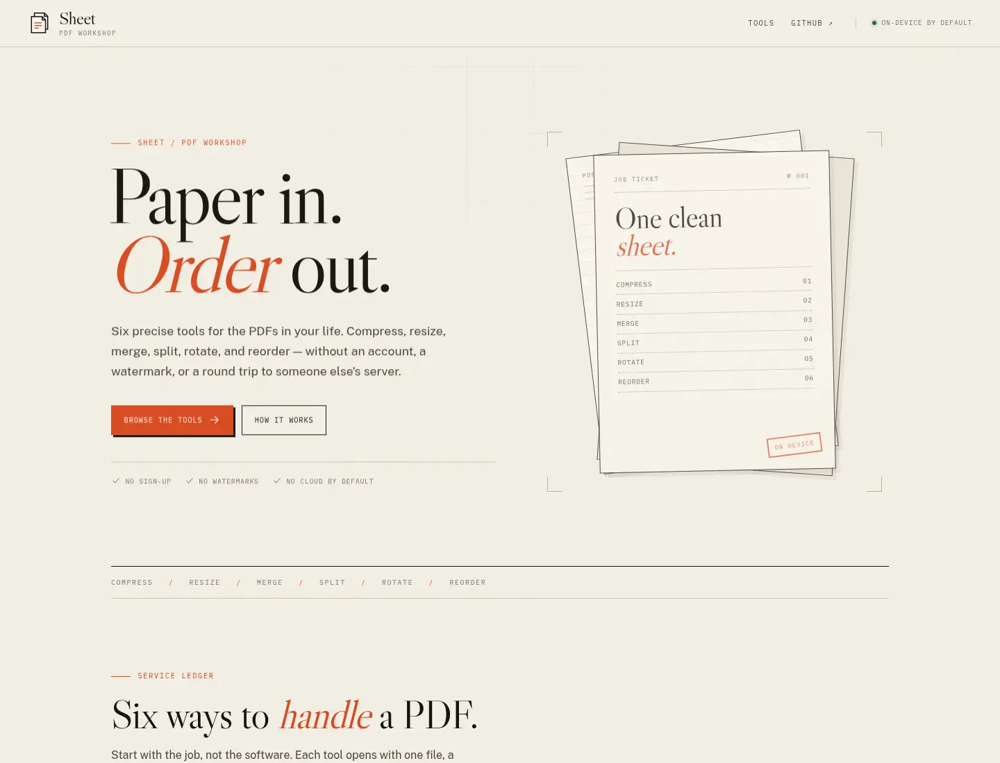
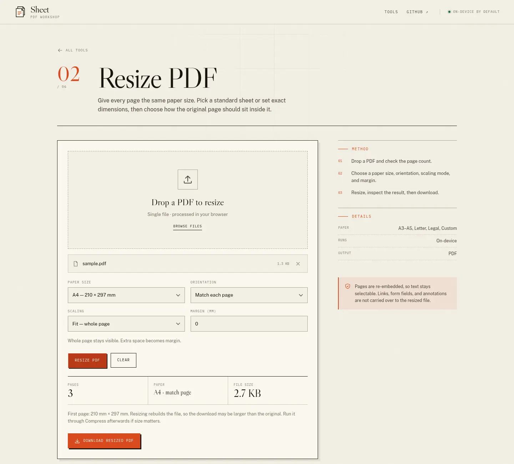

# Sheet — PDF workshop

A local-first PDF toolbox. Six precise tools, no accounts, no watermarks, and no third-party file uploads.

[](https://github.com/sarvkk/pdfresizer/actions/workflows/ci.yml)
[](LICENSE)



## Tools

| Tool | Where it runs | What it does |
| --- | --- | --- |
| **Compress** | Local API or browser | Ghostscript downsampling and image compression, with a structure-only in-browser fallback. |
| **Resize** | Browser | Sets every page to A3–A5, Letter, Legal, or a custom size; controls orientation, fit/fill/stretch, and margins. |
| **Merge** | Browser | Combines PDFs in a draggable queue. |
| **Split** | Browser | Extracts clicked pages or a typed range. |
| **Rotate** | Browser | Rotates selected pages 90°, 180°, or 270° clockwise. |
| **Reorder** | Browser | Rearranges pages by drag-and-drop or keyboard. |

All browser-side work uses [`pdf-lib`](https://pdf-lib.js.org/) and stays in the tab. Compression is the only job that talks to a server — the one on your own machine.



## Requirements

- Node.js 20.12+
- [pnpm](https://pnpm.io)
- [Ghostscript](https://www.ghostscript.com/) (`gs` on `PATH`) for server compression

```bash
# Debian / Ubuntu
sudo apt install ghostscript

# macOS
brew install ghostscript
```

## Development

```bash
pnpm install
pnpm dev
```

This starts:

- Vite at `http://localhost:5173`
- The Hono API at `http://localhost:8787` (proxied as `/api`)

Run them separately with `pnpm dev:web` and `pnpm dev:api`.

## Production

The API server also serves the built frontend, so one process is enough:

```bash
pnpm build
pnpm start:api
# http://localhost:8787
```

To host the frontend separately, deploy `dist/` to any static host, set `VITE_API_BASE_URL` to the API origin at build time, and add that frontend origin to `CORS_ORIGINS` on the API. Use an SPA fallback to `index.html` so client-side routes resolve.

## Configuration

Copy `.env.example` to `.env` if you need to override anything.

| Variable | Used by | Default | Purpose |
| --- | --- | --- | --- |
| `PORT` | API | `8787` | API and production frontend port |
| `CORS_ORIGINS` | API | localhost:5173 / :4173 | Comma-separated browser origins allowed to call the API |
| `VITE_API_BASE_URL` | Frontend | empty | Absolute API origin for split deployments; empty uses the Vite proxy |

## Scripts

| Command | Description |
| --- | --- |
| `pnpm dev` | Frontend + API with hot reload |
| `pnpm build` | Type-check and build the frontend into `dist/` |
| `pnpm start:api` | Serve the API and built frontend |
| `pnpm lint` | Run oxlint |
| `pnpm test` | Run the Node test suite via tsx |
| `pnpm typecheck` | Run `tsc -b` |

## How it is put together

```text
src/
  components/      shared UI (drop zone, page grid, tool shell)
  hooks/           file loading and page metadata
  lib/pdf/         pdf-lib operations: merge, split, rotate, reorder, resize, compress
  pages/           one page per tool, lazy-loaded
server/index.ts    Hono API, Ghostscript runner, static file server
tests/             Node test runner checks for page ranges and resize geometry
```

- **Frontend:** React 19, React Router, Vite, TypeScript.
- **PDF engine:** `pdf-lib` for browser operations.
- **Compression:** Hono + Ghostscript `pdfwrite`, with `/printer`, `/ebook`, and `/screen` presets.
- **Motion and styling:** hand-written CSS, with `prefers-reduced-motion` support.

## Limits and caveats

- Server compression accepts files up to **50 MB** and deletes the temp directory after every request.
- In-browser compression rewrites structure and metadata; it cannot downsample images.
- Resize re-embeds each page. Text remains selectable, but links, form fields, and annotations are not carried into the output.
- Reorder and split copy pages into a new document, so page-level annotations and form fields are not preserved.
- Password-protected PDFs are not supported.

## License

MIT — see [LICENSE](LICENSE).
